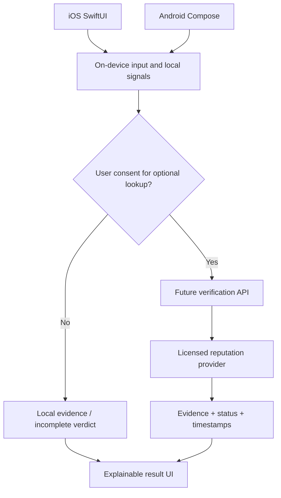

# Architecture and boundaries

This chart is the **target design**, not a claim that the backend exists.

## Native module boundaries

- `features/input`: paste, photo picker, camera; permission prompts only on use.
- `domain`: URL parsing, canonicalized display, evidence, verdict and state machine; unit testable.
- `data`: history storage, privacy settings, remote repository abstraction.
- `features/results`: evidence-driven result cards, safer next steps.
- `design`: platform-specific tokens and components; Figma mapped natively.

Avoid premature microservices, shared UI code, background crawling and network requests from composables/views.

## Optional gateway (future)

- API versioned under `/v1`; use TLS and authenticated/rate-limited access.
- Provider credentials and billing only on server.
- Gateway performs **provider lookup**, not unsafe web browsing.
- No server-controlled fetch of arbitrary hosts, redirects, images or page content.
- Bounded request size, timeouts, cache TTL and abuse controls.
- Clean provider match must result in `NO_KNOWN_THREATS`, not guaranteed safe.
- Provider timeout/unknown state must preserve `UNABLE_TO_VERIFY`.

## Data model

See `contracts/verification.openapi.yaml`. A result should carry:

- `id`, `checkedAt`, `inputKind`, `displayHost`.
- `verdict`, `confidenceExplanation` (never unsupported numerical certainty).
- `evidence[]`: code, severity, message, source, `observedAt`.
- `checks[]`: name, executed/skipped/failed, reason and freshness.
- `recommendedActions[]` and `limitations[]`.

## Error handling

Separate malformed input, denied permission, offline mode, backend timeout, provider unavailable, quota error, stale information and user cancellation. Every failure needs actionable copy and must not masquerade as a passed check.
